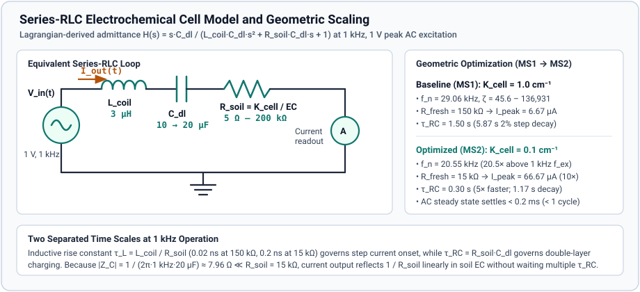
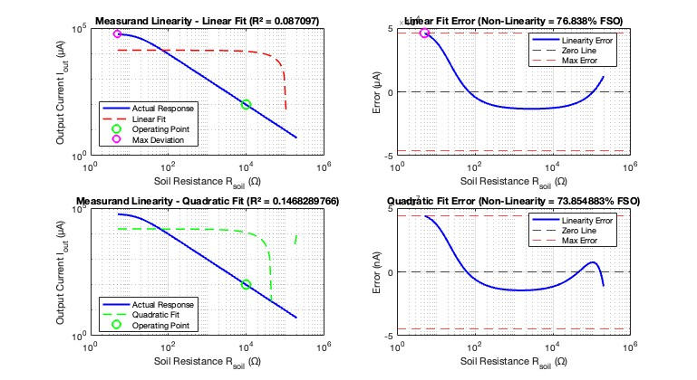
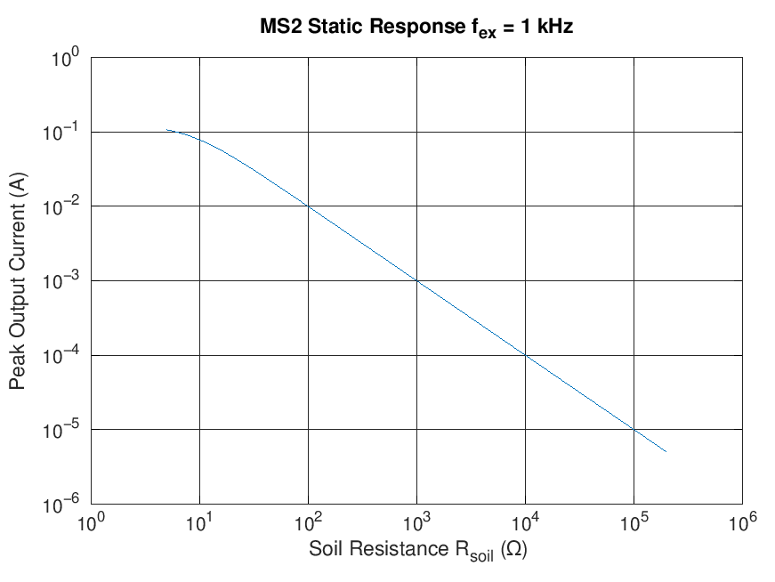
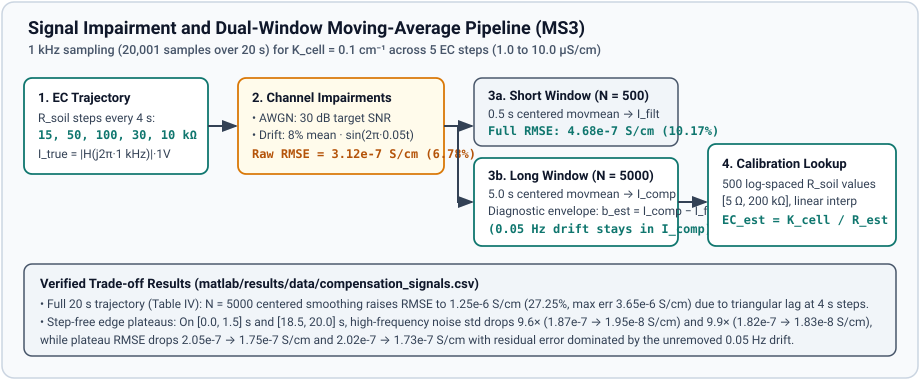
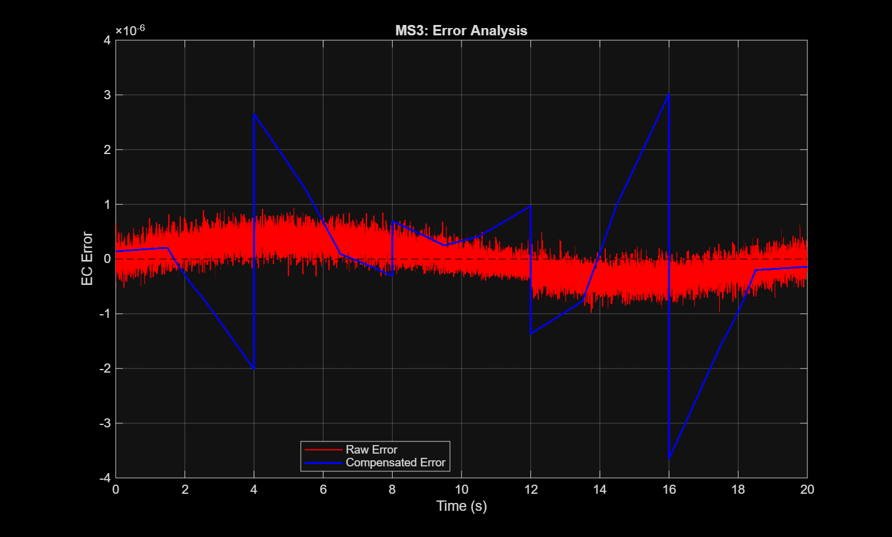
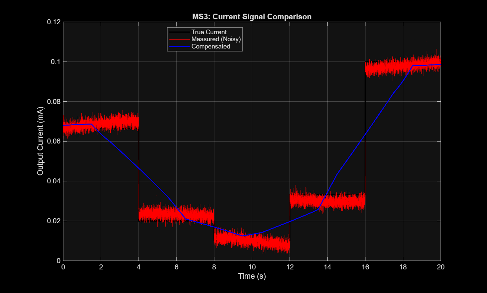

# Soil Salinity (EC) Sensor

[](https://github.com/andrew-abdelmalak/soil-salinity-ec-sensor/actions/workflows/ci.yml)
[](https://github.com/andrew-abdelmalak/soil-salinity-ec-sensor/actions/workflows/paper.yml)
[](LICENSE)

Analytical series-RLC modeling, geometric cell-constant optimization, and digital signal compensation for an agricultural soil electrical conductivity (EC) sensor. We developed this study for the ELCT 903 Sensor Technology course at the German University in Cairo (GUC), accompanied by the compiled IEEE conference manuscript in [docs/Soil_EC_Sensor_Design.pdf](docs/Soil_EC_Sensor_Design.pdf).



## Simulation vs. Hardware Scope

This repository is a simulation, mathematical modeling, and benchmark study. No physical electrode hardware, impedance analyzer measurements, or field data are included here.

- **Reproduced in Python and GNU Octave:** Every analytical transfer function, stiff ODE integration (`ode15s` in Octave and `BDF` in SciPy), static calibration curve, step-response transient, dual-window moving-average trajectory (`compensation_signals.csv`), and weighted commercial benchmark score runs deterministically in CI.
- **MATLAB/Simulink model:** The block model [matlab/ec_sensor_model.slx](matlab/ec_sensor_model.slx) requires desktop Simulink and cannot run in headless Linux CI. Its governing second-order RLC differential equation matches `ode_function.m` and `simulate_dynamic_ode` in [src/soil_sensor/model.py](src/soil_sensor/model.py).
- **Manufacturer specifications:** Commercial probe data come from vendor datasheets cited in [paper/Soil_EC_Sensor_Design.tex](paper/Soil_EC_Sensor_Design.tex) (`atlas2023`, `vernier2025`, `meter2018`). Physical prototyping and 6 to 12 months of soil validation remain future hardware work.

## Key Engineering Findings

Reducing the electrode cell constant from $K_{cell} = 1.0\;\text{cm}^{-1}$ (Milestone 1 baseline) to $K_{cell} = 0.1\;\text{cm}^{-1}$ (Milestone 2 optimized geometry) reduces fresh-water series resistance tenfold ($150\;\text{k}\Omega$ to $15\;\text{k}\Omega$) while doubling $C_{dl}$ from $10\;\mu\text{F}$ to $20\;\mu\text{F}$:

| Parameter / Metric | Baseline (MS1) | Optimized (MS2) | Change |
|---|---:|---:|---:|
| Cell constant $K_{cell}$ | $1.0\;\text{cm}^{-1}$ | $0.1\;\text{cm}^{-1}$ | $10\times$ lower |
| Lead inductance $L_{coil}$ | $3\;\mu\text{H}$ | $3\;\mu\text{H}$ | Unchanged |
| Double-layer capacitance $C_{dl}$ | $10\;\mu\text{F}$ | $20\;\mu\text{F}$ | $2\times$ higher |
| Fresh-water resistance $R_{soil}$ | $150\;\text{k}\Omega$ | $15\;\text{k}\Omega$ | $10\times$ lower |
| Natural frequency $f_n$ | $29.06\;\text{kHz}$ | $20.55\;\text{kHz}$ | $20.55\times f_{ex}$ |
| Damping ratio $\zeta$ ($50\;\Omega$ to fresh) | $45.64$ to $136{,}931$ | $64.55$ to $19{,}365$ | Overdamped |
| Fresh-water peak current at $1\;\text{kHz}$, $1\;\text{V}$ | $6.67\;\mu\text{A}$ | $66.67\;\mu\text{A}$ | $10.0\times$ gain |
| Double-layer charging $\tau_{RC} = R_{soil} C_{dl}$ | $1.50\;\text{s}$ | $0.30\;\text{s}$ | $5.0\times$ faster |
| Analytical 2% step decay time | $5.87\;\text{s}$ | $1.17\;\text{s}$ | $5.0\times$ faster |
| Inductive step rise $\tau_L = L_{coil}/R_{soil}$ | $0.02\;\text{ns}$ | $0.20\;\text{ns}$ | Sub-nanosecond |

At the $1\;\text{kHz}$ operating frequency, capacitive reactance $|Z_C| = 1/(2\pi f_{ex} C_{dl}) \approx 7.96\;\Omega$ is negligible next to $R_{soil} = 15\;\text{k}\Omega$, so steady-state AC current settles in under $0.2\;\text{ms}$ (less than one excitation cycle) without waiting multiple $\tau_{RC}$ cycles.

### Static Sensitivity and Dynamic Trade-offs

| Baseline Linearity Error | Optimized Static Calibration |
|---|---|
|  |  |

Static current scales as $I_{peak} \approx V_{peak}/R_{soil}$, producing $76.8\%$ FSO non-linearity against resistance ($73.9\%$ quadratic) while remaining linear with respect to soil conductivity ($\sigma = K_{cell}/R_{soil}$).

## Noise and Drift Compensation (Milestone 3)



We evaluate a centered moving-average pipeline over a $20\;\text{s}$ synthetic EC sequence ($20{,}001$ samples at $1\;\text{kHz}$, $R_{soil} \in \{15, 50, 100, 30, 10\}\;\text{k}\Omega$ switching every $4\;\text{s}$) corrupted by $30\;\text{dB}$ AWGN and an $8\%$, $0.05\;\text{Hz}$ sinusoidal drift (`matlab/results/data/compensation_signals.csv`):

| Scope | Raw Noisy | Short Window ($N=500$) | Long Window ($N=5000$) |
|---|---:|---:|---:|
| Full $20\;\text{s}$ RMSE [S/cm] | $3.12 \times 10^{-7}$ ($6.78\%$) | $4.68 \times 10^{-7}$ ($10.17\%$) | $1.25 \times 10^{-6}$ ($27.25\%$) |
| Full $20\;\text{s}$ Max Abs. Error [S/cm] | $9.77 \times 10^{-7}$ | $1.99 \times 10^{-6}$ | $3.65 \times 10^{-6}$ |
| Plateau $[0.0, 1.5]\;\text{s}$ noise std [S/cm] | $1.87 \times 10^{-7}$ | $5.25 \times 10^{-8}$ | $1.95 \times 10^{-8}$ ($9.6\times$ lower) |
| Plateau $[18.5, 20.0]\;\text{s}$ noise std [S/cm] | $1.82 \times 10^{-7}$ | $5.36 \times 10^{-8}$ | $1.83 \times 10^{-8}$ ($9.9\times$ lower) |

Because `compensation_filter.m` outputs the $5\;\text{s}$ moving average ($I_{comp}$) directly and uses $b_{est} = I_{comp} - I_{filt}$ only as a diagnostic signal, residual error on flat edge plateaus ($1.75 \times 10^{-7}$ and $1.73 \times 10^{-7}\;\text{S/cm}$ RMSE) is dominated by unsubtracted $0.05\;\text{Hz}$ drift, while full-sequence RMSE increases to $27.25\%$ from triangular smearing across abrupt $4\;\text{s}$ steps.

| EC Estimation Error Over Time | Current Domain Signal Chain |
|---|---|
|  |  |

## Commercial Sensor Benchmarking (Paper Table VI)

Using datasheet specs across eight weighted criteria (Accuracy $25\%$, Range Coverage $20\%$, Response Time $15\%$, Operating Temp. $10\%$, Environmental Suitability $10\%$, Interference Immunity $10\%$, Cost $5\%$, Maintenance $5\%$):

| Criterion | Weight | Atlas Scientific K 1.0 | Vernier CON-BTA | METER 5TE | Optimized Design ($K=0.1$) |
|---|---:|---:|---:|---:|---:|
| Range Coverage | 20% | 10 | 6 | 7 | 10 |
| Accuracy | 25% | 10 | 9 | 6 | 8 |
| Response Time | 15% | 7 | 5 | 10 | 10 |
| Operating Temp. | 10% | 9 | 7 | 10 | 7 |
| Environ. Suit. | 10% | 8 | 6 | 10 | 9 |
| Interference Imm. | 10% | 9 | 8 | 7 | 8 |
| Cost | 5% | 8 | 7 | 5 | 10 |
| Maintenance | 5% | 9 | 8 | 9 | 7 |
| **Weighted Total** | **100%** | **9.00** | **7.05** | **7.80** | **8.75** |

## Quick Start

### Python Verification Package (`uv`)

Requires Python 3.11+ and [uv](https://docs.astral.sh/uv/).

```bash
git clone https://github.com/andrew-abdelmalak/soil-salinity-ec-sensor.git
cd soil-salinity-ec-sensor
uv sync --locked
uv run pytest -v
uv run python -m soil_sensor
```

Example output from `uv run python -m soil_sensor`:

```text
Soil Salinity (EC) Sensor - Python Verification Summary
================================================================
Natural frequency (MS1):         29.06 kHz
Natural frequency (MS2):         20.55 kHz (20.55x f_ex=1 kHz)
Damping ratio (MS1):             45.64 (50 Ohm) to 136,931 (150 kOhm)
Fresh-water R_soil:              150 kOhm -> 15 kOhm (10x reduction)
Fresh-water peak current:        6.67 uA -> 66.67 uA (10.0x gain)
RC double-layer tau_RC:          1.50 s -> 0.30 s (5.0x faster)
Inductive rise tau_L:            2.00e-11 s -> 2.00e-10 s
Static non-linearity (MS1):      76.8% FSO (linear), 73.9% FSO (quadratic)
Stiff BDF ODE peak (MS2, 10 ms): 66.70 uA
```

### MATLAB / GNU Octave Simulation Suite

All 11 `.m` scripts run headlessly in GNU Octave 9.2.0 via the shims in [matlab/compat/](matlab/compat/):

```bash
docker run --rm \
  -v "$(pwd)/matlab:/work" \
  -w /work \
  gnuoctave/octave@sha256:100d394c57b86469748d26ddafcf73a1074338a66dabcababe2e4e05146772b9 \
  octave-cli --no-gui --quiet run_all.m
```

In desktop MATLAB, run `matlab/run_all.m` directly (set `EC_COMP_OUT_DIR=results` before running if you want `noise_compensation_main.m` to overwrite the archived Milestone 3 CSVs).

### Build the IEEE Paper PDF

```bash
docker run --rm \
  -v "$(pwd)/paper:/work" \
  -w /work \
  texlive/texlive@sha256:7056390eac37715fd3e01875037ceb4016cb17d44c611f7bbbfa7a012007979f \
  latexmk -pdf -interaction=nonstopmode Soil_EC_Sensor_Design.tex
```

## Repository Structure

| Path | Purpose |
|---|---|
| [src/soil_sensor/](src/soil_sensor/) | Python analytical model, BDF ODE solver, compensation pipeline, and CLI |
| [tests/](tests/) | 21 `pytest` checks comparing Python equations against theory and CSV outputs |
| [matlab/](matlab/) | Baseline (MS1), optimized (MS2), and DSP compensation (MS3) scripts plus `run_all.m` |
| [matlab/compat/](matlab/compat/) | Octave 9.2 compatibility shims for MATLAB Control System and table APIs |
| [matlab/results/](matlab/results/) | Generated CSV datasets and plotted figures |
| [paper/](paper/) | IEEE conference manuscript LaTeX source (`IEEEtran`) and figure assets |
| [docs/](docs/) | Compiled paper PDF (`Soil_EC_Sensor_Design.pdf`), architecture SVGs, social preview |
| [.github/](.github/) | Pinned GitHub Actions workflows, Dependabot config, and community templates |

## Authors

Developed by Andrew Abdelmalak (listed on the IEEE paper as Andrew Khalil), Daniel George, David Louis, Samir Sameh, and Youssef Youssry for ELCT 903 Sensor Technology, Department of Mechatronics Engineering, German University in Cairo.

## Citation and License

Cite this repository using [CITATION.cff](CITATION.cff). Released under the [MIT License](LICENSE).
